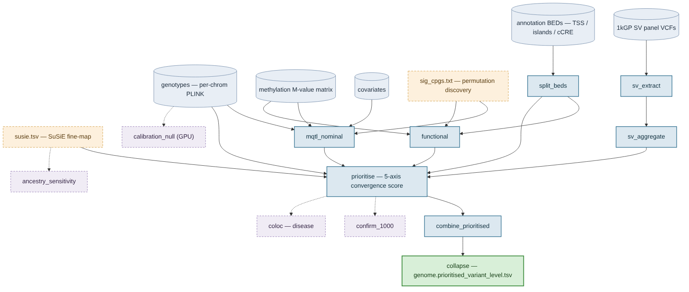

# A reproducible, CpG-centric framework for cis-mQTL variant prioritization

Multi-ancestry cis-methylation-QTL mapping and functional variant prioritization in
**1000 Genomes ONT long-read data** (n = 452; five superpopulations: AFR, EUR, EAS, SAS, AMR).
The framework discovers cis-mQTLs, fine-maps them, and ranks variants by a **five-axis
convergence score**, then integrates with disease GWAS — packaged as a single-command,
resume-aware [Snakemake](https://snakemake.readthedocs.io) pipeline that runs end-to-end
on NCI Gadi and re-runs on any new cohort by swapping one config.

*Author:* Rohit Jayasankar (UWA Master of Bioinformatics) · *Supervisors:* Dr Sam Buckberry,
Dr Dave Edwards · hosted by the Epigenetics team, Kids Research Institute Australia.

---

## The pipeline



**Blue cylinders** are raw inputs, **orange dashed** are pre-existing upstream inputs,
**blue boxes** are Snakemake rules, **green** is the final output, **purple dashed** are
parallel analysis branches. An always-in-sync version is auto-generated at
`docs/rulegraph.png` (`snakemake --rulegraph | dot -Tpng`).

Everything funnels into **`prioritise`**, which computes the five-axis convergence score
per variant:

| Axis | Signal | Source rule / input |
|------|--------|---------------------|
| 1 | Fine-mapping PIP > 0.9 | SuSiE (`susie.tsv`) |
| 2 | Allele-specific methylation (ASM) | ASM aggregation |
| 3 | ENCODE cCRE overlap | `functional` |
| 4 | Structural-variant linkage | `sv_extract` → `sv_aggregate` |
| 5 | Top effect-size quintile | `mqtl_nominal` |

---

## How it works

Each stage is a **rule** that declares its `input:` and `output:` files. Snakemake reads
all the rules and derives the execution order itself by matching one rule's output to the
next rule's input — you never script the order. Asking for the final file makes Snakemake
work backwards to raw inputs, then run forwards, **skipping anything already up to date**.

- **One command** runs the whole DAG; independent chromosomes/branches run in parallel.
- **Resume-aware:** re-running only does what's missing or stale.
- **Config-driven:** every path and parameter lives in `config/config.yaml` — reproduce on
  a new cohort by swapping paths, nothing else.
- **Cluster-native:** with the PBS profile, each rule becomes its own right-sized `qsub`
  job (GPU where needed).

---

## Quick start (NCI Gadi)

```bash
# environment (one-time)
micromamba create -n smk -c bioconda -c conda-forge \
    snakemake-minimal snakemake-executor-plugin-cluster-generic graphviz
micromamba activate smk
export XDG_CACHE_HOME=/g/data/cy94/$USER/.cache      # keep caches off home (quota)

# dry-run: show the DAG and what WOULD execute (always do this first)
snakemake -n

# full run — each rule submitted as its own PBS job
snakemake --profile profile/pbs
```

The default target is `genome.prioritised_variant_level.tsv` (the ranked variant list).
Run a single stage with its aggregator, e.g. `snakemake mqtl_nominal_all --profile profile/pbs`.

## Reproduce on a new cohort (e.g. PROPHECY)

```bash
cp config/config.yaml config/prophecy.yaml
# edit prophecy.yaml: point mqtl_in / downstream / genotypes at the new cohort
snakemake --configfile config/prophecy.yaml --profile profile/pbs
```

Identical code and parameters, new data — that's the reproducibility guarantee.

---

## Stages

| Rule | Does | Was (legacy script) |
|------|------|---------------------|
| `split_beds` | Per-chrom TSS / CpG-island / cCRE BEDs | awk inside func/prioritise |
| `sv_extract` → `sv_aggregate` | SV genotypes → per-variant SV linkage | `sv_extract_gw.pbs`, `sv_agg.pbs` |
| `mqtl_nominal` | cis-mQTL nominal pass per chrom | `run_nominal_gw.pbs` |
| `functional` | TSS / island / cCRE annotation | `func_annot_gw.pbs` |
| `prioritise` | Five-axis convergence score | `prioritise_{gw,c12,big}.pbs` → **one rule** |
| `combine_prioritised` → `collapse` | Genome table → variant-level ranking | `collapse.pbs` |
| `calibration_null` | GPU null-permutation λ calibration | `lambda_null_genomewide.pbs` |
| `confirm_1000` | 1000-perm confirmation on top hits | `confirm_perm_1000.pbs` |
| `coloc` | Disease colocalisation (eGFR) | `coloc_egfr_array.pbs` |
| `ancestry_sensitivity` | Per-superpopulation SMR sensitivity | `ancestry_*.pbs` |

**Two consolidations** done during packaging: the single-file vs split-and-merged nominal
outputs (chr1/chr2) are unified behind a canonical `{chrom}.nominal.parquet`; and the three
near-duplicate prioritise scripts collapse into one `prioritise` rule.

---

## Repo layout

```
Snakefile                 # top-level: config + includes + default target
rules/
  mqtl_nominal.smk        # nominal mapping stage
  downstream.smk          # SV, functional, prioritise, collapse, + branches
config/config.yaml        # all paths + the 5-axis parameters
profile/pbs/
  config.yaml             # Snakemake cluster-generic profile
  qsub.sh                 # GPU-aware submit wrapper (forwards XDG_CACHE_HOME)
  qstat-status.sh         # PBS job-status checker
scripts/                  # the stage scripts the rules wrap
docs/                     # pipeline_dag.png, rulegraph.png
```

## Requirements

- Snakemake 9 + `snakemake-executor-plugin-cluster-generic`
- Per-stage conda envs (`mqtl_tensorqtl`, `mqtl_modkit`) — tensorQTL, plink2, bcftools/tabix
- NCI Gadi (PBSPro), project with `normal` + `gpuvolta` allocation

## Status & upstream inputs

The discovery stages that produce two inputs the DAG currently starts from —
**SuSiE fine-mapping** (`susie.tsv`) and the **permutation-derived significant CpGs**
(`sig_cpgs.txt`), plus the **ASM-rescore** step — exist as scripts and completed outputs,
and are being folded in as rules. Until then the pipeline begins from those intermediate
files (documented, standard practice for a published workflow).

## Pre-release checklist (before making public)

Keep this repository **private until publication** (thesis release / preprint). Before
flipping it public:

- [ ] No credentials, tokens, or participant-level data committed (1000 Genomes is open;
      keep any future cohort data out via `.gitignore`)
- [ ] Generalise hardcoded `/scratch/cy94/rs4477/...` paths into `config.yaml`
- [ ] Wire the three upstream scripts (finemap, sig-CpG discovery, ASM-rescore) as rules
- [ ] Tag `v1.0` and mint a **Zenodo DOI** from the GitHub release
- [ ] Supervisor sign-off (Sam / Dave)
